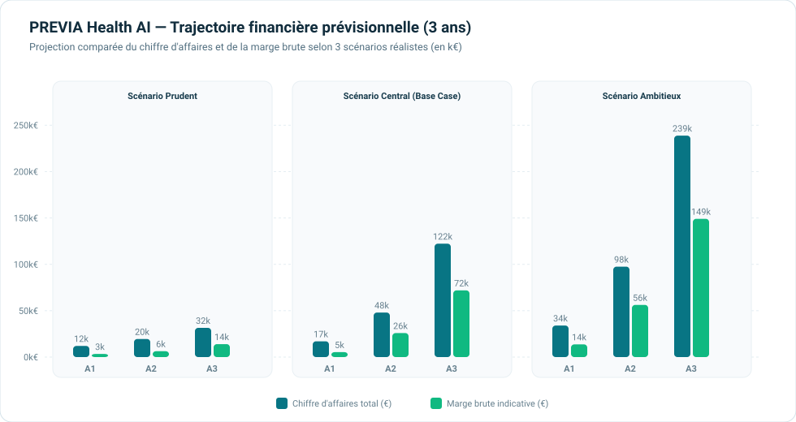
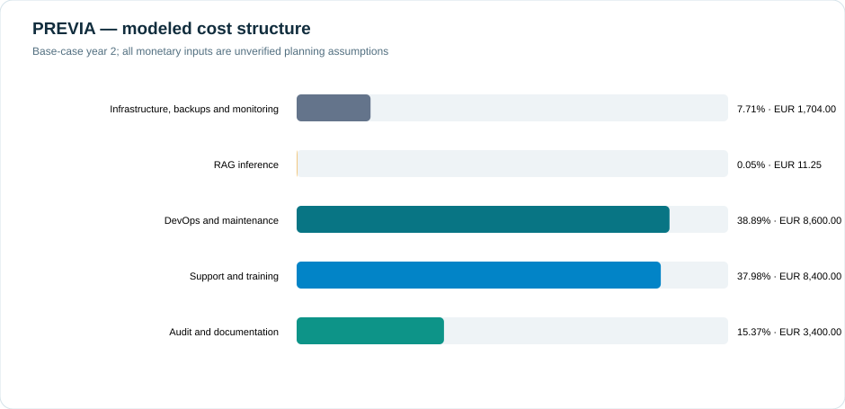

# Analyse financière auditée de PREVIA

**Statut : modèle de planification reproductible, non contractuel et non audité.** Les montants ci-dessous ne sont ni des ventes réalisées, ni des devis fournisseurs, ni des comptes certifiés.

## Correction de la règle de chiffre d'affaires

| Produit | Prix indicatif | Règle de revenu |
|---|---:|---|
| Pilote encadré | 12 000 € | nombre de pilotes × 12 000 € |
| Campagne | 2 500 € | nombre de campagnes × 2 500 € |
| Licence annuelle | 15 000 € | nombre de licences × 15 000 € |

Le générateur précédent ajoutait 0,30 € pour des profils supposés « supplémentaires ». Cette recette a été supprimée : les scénarios ne contiennent aucun champ de dépassement facturable et les profils ne sont pas affectés de manière exclusive à une campagne, un pilote ou une licence. Le revenu complémentaire est donc **0 € dans les neuf scénarios**.

## Scénarios corrigés

| Scénario | Année | Pilotes | Campagnes | Licences | Profils (hypothèse) | CA | Coûts modélisés | Marge modélisée | Marge | Coût total/profil |
|---|---:|---:|---:|---:|---:|---:|---:|---:|---:|---:|
| Prudent | A1 | 1 | 0 | 0 | 1 000 | 12 000 € | 8 644,45 € | 3 355,55 € | 27,96 % | 8,64 € |
| Prudent | A2 | 1 | 3 | 0 | 8 500 | 19 500 € | 13 147,83 € | 6 352,17 € | 32,58 % | 1,55 € |
| Prudent | A3 | 0 | 6 | 1 | 20 000 | 30 000 € | 17 533,00 € | 12 467,00 € | 41,56 % | 0,88 € |
| Central | A1 | 1 | 2 | 0 | 6 000 | 17 000 € | 11 646,70 € | 5 353,30 € | 31,49 % | 1,94 € |
| Central | A2 | 0 | 6 | 2 | 25 000 | 45 000 € | 22 115,25 € | 22 884,75 € | 50,85 % | 0,88 € |
| Central | A3 | 0 | 15 | 5 | 70 000 | 112 500 € | 50 335,50 € | 62 164,50 € | 55,26 % | 0,72 € |
| Ambitieux | A1 | 2 | 4 | 0 | 12 000 | 34 000 € | 20 309,40 € | 13 690,60 € | 40,27 % | 1,69 € |
| Ambitieux | A2 | 0 | 12 | 4 | 55 000 | 90 000 € | 41 248,75 € | 48 751,25 € | 54,17 % | 0,75 € |
| Ambitieux | A3 | 0 | 25 | 10 | 150 000 | 212 500 € | 89 711,50 € | 122 788,50 € | 57,78 % | 0,60 € |



Les profils sont des hypothèses opérationnelles et ne génèrent aucun revenu additionnel. Les marges dépendent de toutes les hypothèses de coûts; elles ne sont pas acquises.

## Audit des coûts

### Infrastructure réellement identifiable

- frontend déployé sur Vercel;
- API PREVIA déployée sur un serveur Netcup;
- Knowlia appelé par intégration API privée;
- API publique sur `api.previa.koryxa.fr`.

Ces éléments prouvent l'architecture utilisée, **pas le prix payé**.

| Classe | Éléments disponibles |
|---|---|
| Dépenses observées avec justificatif | aucune facture dans le dépôt |
| Devis fournisseurs | aucun devis dans le dépôt |
| Contrats ou ventes | aucun contrat signé dans le dépôt |
| Hypothèses | VPS 25 €/mois/instance; Vercel 20 €/mois; domaine 24 €/an; sauvegarde/monitoring 180 €/instance/an; maintenance, support, audit et tokens selon `cost_inputs.csv` |
| Propriété technique | le calcul OMS déterministe ne consomme pas de jetons LLM |

La présence d'un abonnement Vercel Pro, de sauvegardes chiffrées, de Sentry ou d'un coût Knowlia de 0,0015 €/requête n'est pas démontrée par une pièce justificative dans le dépôt. Ces valeurs restent des hypothèses.

### Ventilation recalculée — scénario central A2

- infrastructure, sauvegardes et monitoring : 1 704,00 € (7,71 %);
- inférence RAG : 11,25 € (0,05 %);
- DevOps et maintenance : 8 600,00 € (38,89 %);
- support et formation : 8 400,00 € (37,98 %);
- audit et documentation : 3 400,00 € (15,37 %).



## Coût par profil

- **Coût total modélisé par profil** : tous les coûts divisés par le volume hypothétique; de 8,64 € à 0,60 € selon le scénario.
- **Coût technique modélisé par profil** : infrastructure et tokens uniquement; il exclut travail humain, support et audit.

Le KPI de 0,50 € est une cible proposée pour un futur coût technique direct mesuré sur factures. Il n'est pas un résultat atteint.

## Seuil de rentabilité sans double comptage

- charges annuelles fixes modélisées : 3 944 €;
- coût incrémental d'une campagne : 1 500 €;
- contribution d'une campagne : 1 000 €;
- coût incrémental d'une licence : 4 100 €;
- contribution d'une licence : 10 900 €.

Résultats continus : 3,944 campagnes ou 0,362 licence. Une fraction de contrat n'étant pas vendable, le seuil commercial est **4 campagnes complètes ou 1 licence complète**, sous réserve de validation des hypothèses. Les charges fixes ne sont pas soustraites une seconde fois des contributions.

## Reproductibilité

```powershell
& .\.venv\Scripts\python.exe scripts\evaluate_business_pilot.py
& .\.venv\Scripts\python.exe -m pytest backend\tests\test_business_pilot.py -q
```

Les données et hypothèses sont dans [`results/`](results/). Avant toute décision, elles doivent être remplacées par factures, devis, temps de travail et conditions contractuelles documentés.
