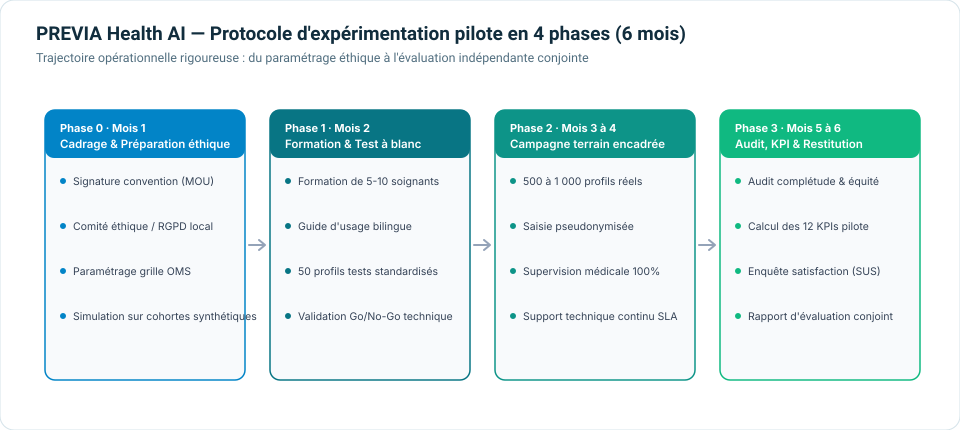

# Plan proposé pour un futur pilote supervisé

**Ce plan est une proposition. Aucun partenaire n'est engagé et aucune cible n'est un résultat atteint.**

## Conditions préalables obligatoires

Avant toute inclusion de personnes réelles :

1. partenaire de santé identifié et responsabilités contractuelles définies;
2. approbation éthique et autorisations réglementaires/locales applicables;
3. qualification du produit et de son usage prévu par des spécialistes compétents;
4. protocole clinique local approuvé, critères d'inclusion/exclusion et procédure d'orientation;
5. responsable de traitement, base légale/consentement, information des participants et droits d'accès;
6. analyse d'impact relative à la protection des données si nécessaire;
7. minimisation, pseudonymisation, chiffrement, habilitations, journalisation, durée de conservation et effacement;
8. supervision humaine de chaque résultat, mécanisme de dérogation et absence de prescription automatisée;
9. plan de gestion des incidents, arrêt, notification et reprise;
10. plan statistique et indicateurs préenregistrés, avec comparateur réel documenté.

La règle « aucune persistance » du prototype ne suffit pas à gouverner un pilote : les besoins de suivi exigeraient un système autorisé et séparé, conçu avec le partenaire.

## Séquence proposée

### Phase 1 — Gouvernance et protocole

- confirmer population, sites, parcours, comparateur et responsabilités;
- obtenir les autorisations;
- documenter les flux et la conservation des données;
- figer les versions de la grille, du logiciel, du RAG et des procédures;
- définir les seuils d'arrêt et l'adjudication indépendante.

### Phase 2 — Test à blanc

- formation des utilisateurs;
- cas synthétiques couvrant bornes, erreurs et groupes;
- contrôle de la concordance logicielle et des journaux;
- exercices d'incident, d'indisponibilité et de dérogation humaine;
- décision documentée Go/No-Go.

### Phase 3 — Pilote prospectif supervisé

- inclusion uniquement selon le protocole approuvé;
- confirmation humaine avant toute orientation;
- collecte des délais, erreurs, dérogations, incidents et suites du parcours;
- suivi de la qualité des données et des écarts entre groupes;
- aucun changement silencieux de modèle, règle ou prompt.

La taille et la durée seront déterminées par le critère principal, le volume du site, la variabilité attendue, les pertes de suivi et le plan statistique. Les anciens nombres de 500–1 000 participants et six mois restent des options de planification, pas un protocole justifié par un calcul d'effectif.

### Phase 4 — Analyse indépendante

- verrouiller et nettoyer les données selon le plan;
- analyser en intention de traiter si le plan le permet;
- rapporter estimations et incertitude, données manquantes et incidents;
- publier également les résultats négatifs;
- décision de poursuivre, modifier ou arrêter.

## Critères d'arrêt évaluables

- incident grave de confidentialité ou de sécurité;
- orientation non supervisée ou usage hors protocole;
- divergence logicielle inexpliquée avec la table de référence;
- indisponibilité dépassant le seuil préspécifié pendant une session;
- taux d'erreurs, données manquantes ou disparité dépassant un seuil approuvé;
- capacité insuffisante pour assurer la revue humaine et le suivi.

Ces critères doivent être définis numériquement et approuvés avant le pilote; ils ne sont pas des garanties d'absence d'incident.

## Séparation scientifique

- grille OMS : estimation cardiovasculaire régionale discrète;
- modèle NHANES : association exploratoire HbA1c, non prédicteur cardiovasculaire;
- SHAP : explication du modèle NHANES, non preuve causale;
- allocation : simulation de ressources, non triage validé;
- RAG/Knowlia : synthèse documentaire, non décision clinique.

Le protocole complet de mesure du chantier 15 reste la référence : [protocole de futur pilote](../health-impact/pilot-protocol-fr.md).
