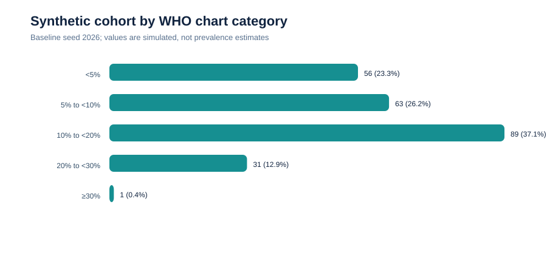
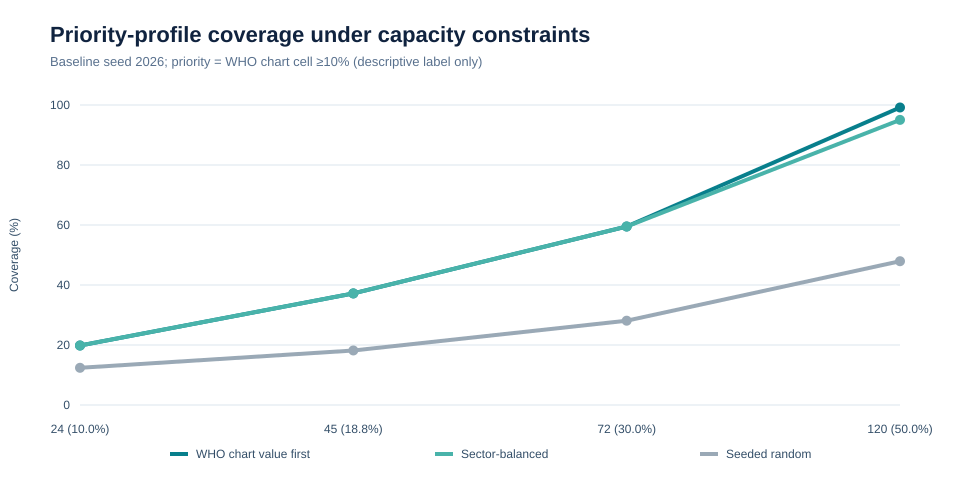
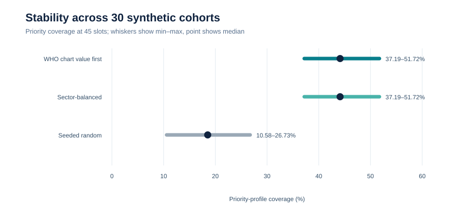
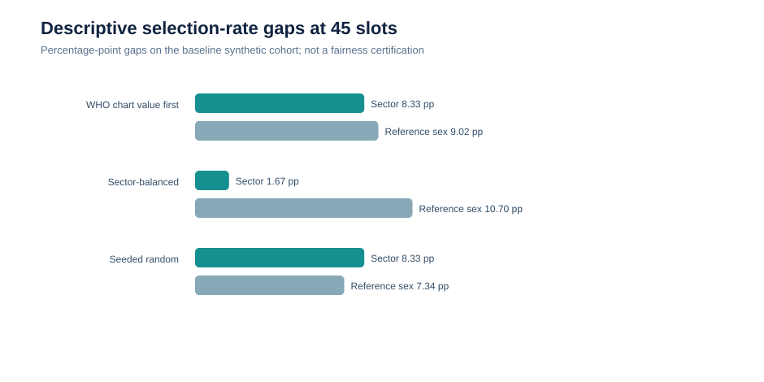

# PREVIA potential health-impact assessment

**Status:** reproducible quantitative demonstration using entirely synthetic data. **This report is not clinical validation.**

## Executive conclusion

PREVIA verifiably demonstrates three capabilities that could support a future health-system experiment: traceable application of a WHO cardiovascular chart to synthetic profiles, explicit comparison of limited-capacity allocation rules, and visibility into trade-offs between coverage of a chart-defined category and selection gaps between groups.

In the baseline scenario (240 artificial profiles, seed 2026), 121 profiles fall in the descriptive “WHO chart cell ≥10%” category. With 45 slots, `chart_descending` and `sector_balanced` each select 45 of them (37.19% coverage); the random baseline selects 22 (18.18%). Across 30 synthetic seeds, median coverage at 45 slots is 44.12%, 44.12%, and 18.52%, respectively.

This advantage on the WHO-based indicator **is not independent validation**: the same chart defines both ranking and success. It establishes consistency with the selected allocation rule, not an ability to improve health outcomes.

## Executed data and experiments

- 30 independent artificial cohorts, fixed seeds 2026–2055;
- 240 profiles per cohort;
- capacities of 24, 45, 72, and 120 slots (10.00%, 18.75%, 30.00%, and 50.00%);
- three product strategies: descending WHO chart value, balanced selection rates across four fictional sectors, and reproducible pseudorandom selection;
- descriptive threshold: WHO chart-cell value ≥10%;
- no patient data, national prevalence, real referral, or clinical outcome.

The generator uses arbitrary distributions solely to test software: uniform age 40–74, randomly assigned chart-reference sex, fixed 22% smoking probability, uniform systolic blood pressure 105–190 mmHg, uniform BMI 19.0–39.0, and cyclic assignment to four fictional sectors.

## Calculated results

### Baseline distribution, seed 2026

| WHO chart-cell category | Profiles | Synthetic share |
|---|---:|---:|
| <5% | 56 | 23.33% |
| 5% to <10% | 63 | 26.25% |
| 10% to <20% | 89 | 37.08% |
| 20% to <30% | 31 | 12.92% |
| ≥30% | 1 | 0.42% |
| **Total** | **240** | **100.00%** |

These proportions describe only the generated cohort and are not prevalence estimates for Togo, Ghana, or any other country.

### Coverage under capacity constraints, seed 2026

| Slots | Strategy | Priority profiles selected | ≥10% category coverage | Yield among selected |
|---:|---|---:|---:|---:|
| 24 | Descending WHO value | 24/121 | 19.83% | 100.00% |
| 24 | Sector-balanced | 24/121 | 19.83% | 100.00% |
| 24 | Reproducible random | 15/121 | 12.40% | 62.50% |
| 45 | Descending WHO value | 45/121 | 37.19% | 100.00% |
| 45 | Sector-balanced | 45/121 | 37.19% | 100.00% |
| 45 | Reproducible random | 22/121 | 18.18% | 48.89% |
| 72 | Descending WHO value | 72/121 | 59.50% | 100.00% |
| 72 | Sector-balanced | 72/121 | 59.50% | 100.00% |
| 72 | Reproducible random | 34/121 | 28.10% | 47.22% |
| 120 | Descending WHO value | 120/121 | 99.17% | 100.00% |
| 120 | Sector-balanced | 115/121 | 95.04% | 95.83% |
| 120 | Reproducible random | 58/121 | 47.93% | 48.33% |

The trade-off becomes visible at high capacity: sector balancing reserves capacity for each sector and can therefore leave some ≥10% profiles unselected, while strict chart ordering selects almost all of them.

### Stability across 30 synthetic cohorts

| Slots | Strategy | Coverage min | Median | Max |
|---:|---|---:|---:|---:|
| 24 | Descending WHO value | 19.83% | 23.53% | 27.59% |
| 24 | Sector-balanced | 19.83% | 23.53% | 27.59% |
| 24 | Reproducible random | 3.85% | 10.41% | 14.17% |
| 45 | Descending WHO value | 37.19% | 44.12% | 51.72% |
| 45 | Sector-balanced | 37.19% | 44.12% | 51.72% |
| 45 | Reproducible random | 10.58% | 18.52% | 26.73% |
| 72 | Descending WHO value | 59.50% | 70.59% | 82.76% |
| 72 | Sector-balanced | 59.50% | 70.25% | 81.82% |
| 72 | Reproducible random | 22.99% | 29.35% | 36.78% |
| 120 | Descending WHO value | 99.17% | 100.00% | 100.00% |
| 120 | Sector-balanced | 92.50% | 100.00% | 100.00% |
| 120 | Reproducible random | 43.18% | 50.55% | 60.53% |

These ranges measure sensitivity to different artificial cohorts. They are neither confidence intervals nor population uncertainty estimates.

### Descriptive group gaps

At 45 slots and seed 2026, the sector selection-rate gap is 8.33 percentage points for chart ordering, 1.67 for sector balancing, and 8.33 for random selection. Across 30 seeds, the respective medians are 10.00, 1.67, and 10.00 points.

The balanced rule therefore achieves its algorithmic objective on fictional sectors. It does not guarantee equal ≥10% coverage, appropriate referral, actual access to care, or equitable outcomes. Reference-sex gaps and high-category coverage gaps remain available in the CSV evidence to avoid reducing equity to one dimension.

## Confirmed findings

1. All strategies use the same cohort and capacity.
2. Selections are deterministic for a configuration, duplicate-free, and capacity-bounded.
3. Category and subgroup denominators reconcile.
4. Greater capacity increases calculated coverage.
5. Sector balancing materially reduces fictional sector selection-rate gaps.
6. Results and SHA-256 fingerprints can be regenerated from the repository.

## Not demonstrated

- patient-level sensitivity, specificity, calibration, discrimination, or predictive value;
- reduced myocardial infarctions, strokes, hospitalisations, or deaths;
- improved referral, follow-up, adherence, or timeliness;
- geographic representativeness or local prevalence;
- clinical equity, safety, cost-effectiveness, or causal impact.

## Separation of scientific components

| Component | Purpose | Use in this assessment | Prohibited interpretation |
|---|---|---|---|
| WHO 2019 non-laboratory chart | Discrete regional ten-year CVD reference value | Ranking and descriptive category | A validated new PREVIA model |
| Frozen NHANES model | Exploratory association with measured HbA1c ≥5.7% | Not used in allocation | Cardiovascular predictor |
| SHAP | Local explanation of the NHANES model | Not used in WHO calculations | Causal evidence or WHO explanation |
| Allocation simulation | Synthetic slot allocation | Primary experiment | Triage decision or real health benefit |
| RAG/Knowlia assistant | Source-grounded documentary synthesis | Not used in calculations | Clinical decision engine |

## Defensible potential value

Subject to future validation, PREVIA could make prioritisation rules explicit, compare capacity constraints before a pilot, identify artificial profiles left unselected, and create an auditable decision trail. Its current value is transparency and controlled experimentation—not proof of improved health.

See [methodology-en.md](methodology-en.md) for the full method and [pilot-protocol-en.md](pilot-protocol-en.md) for the required real-world evaluation.
