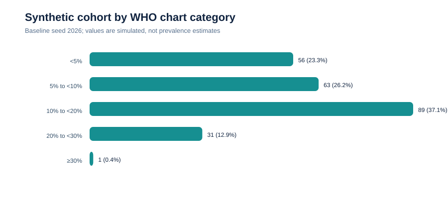
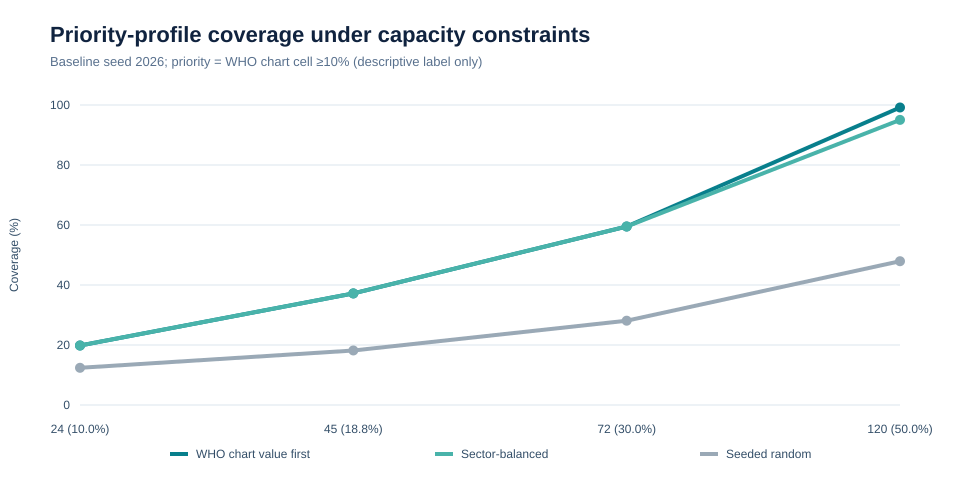
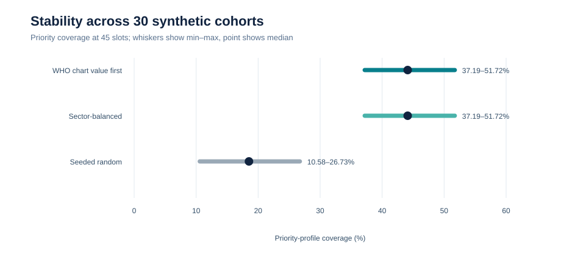
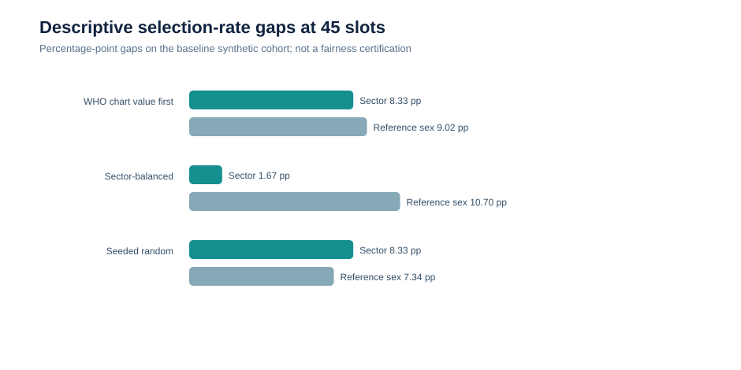

# Évaluation de l'impact sanitaire potentiel de PREVIA

**Statut :** démonstration quantitative reproductible sur données entièrement synthétiques. **Ce rapport n'est pas une validation clinique.**

## Conclusion exécutive

PREVIA démontre de façon vérifiable trois capacités techniques utiles à une future expérimentation sanitaire : appliquer de manière traçable une grille cardiovasculaire OMS à des profils synthétiques, comparer des règles explicites d'allocation de capacités limitées, et rendre visibles les compromis entre couverture d'une catégorie de risque et écarts de sélection entre groupes.

Dans le scénario de référence (240 profils artificiels, graine 2026), 121 profils appartiennent à la catégorie descriptive « cellule OMS ≥10 % ». Avec 45 places, les stratégies `chart_descending` et `sector_balanced` en sélectionnent 45, soit 37,19 % de cette catégorie; la référence aléatoire en sélectionne 22, soit 18,18 %. Sur 30 graines synthétiques, la couverture médiane à 45 places est respectivement de 44,12 %, 44,12 % et 18,52 %.

Cette supériorité sur l'indicateur OMS **n'est pas une validation indépendante** : la grille sert à la fois au classement et à la définition du succès. Le résultat établit la cohérence d'une allocation avec la règle choisie, pas sa capacité à améliorer un résultat de santé.

## Données et expériences exécutées

- 30 cohortes artificielles indépendantes, graines fixes 2026 à 2055;
- 240 profils par cohorte;
- capacités de 24, 45, 72 et 120 places (10,00 %, 18,75 %, 30,00 % et 50,00 %);
- trois stratégies existantes du produit : valeur OMS décroissante, équilibrage des taux de sélection entre quatre secteurs fictifs, tirage pseudo-aléatoire reproductible;
- seuil descriptif : valeur de cellule de la grille OMS ≥10 %;
- aucune donnée patient, prévalence nationale, orientation réelle ou issue clinique.

La cohorte synthétique utilise des distributions arbitraires : âge uniforme entre 40 et 74 ans, sexe de référence tiré à parts aléatoires, tabagisme à probabilité fixe de 22 %, pression systolique uniforme de 105 à 190 mmHg, IMC uniforme de 19,0 à 39,0 et affectation cyclique à quatre secteurs fictifs. Ces choix servent uniquement à tester le logiciel.

## Résultats calculés

### Répartition de référence, graine 2026

| Catégorie de cellule OMS | Profils | Part synthétique |
|---|---:|---:|
| <5 % | 56 | 23,33 % |
| 5 % à <10 % | 63 | 26,25 % |
| 10 % à <20 % | 89 | 37,08 % |
| 20 % à <30 % | 31 | 12,92 % |
| ≥30 % | 1 | 0,42 % |
| **Total** | **240** | **100,00 %** |

Ces proportions décrivent uniquement la cohorte générée et ne sont pas des estimations de prévalence au Togo, au Ghana ou dans un autre pays.

### Couverture sous contrainte de capacité, graine 2026

| Places | Stratégie | Prioritaires sélectionnés | Couverture catégorie ≥10 % | Rendement dans la sélection |
|---:|---|---:|---:|---:|
| 24 | Valeur OMS décroissante | 24/121 | 19,83 % | 100,00 % |
| 24 | Équilibrage sectoriel | 24/121 | 19,83 % | 100,00 % |
| 24 | Aléatoire reproductible | 15/121 | 12,40 % | 62,50 % |
| 45 | Valeur OMS décroissante | 45/121 | 37,19 % | 100,00 % |
| 45 | Équilibrage sectoriel | 45/121 | 37,19 % | 100,00 % |
| 45 | Aléatoire reproductible | 22/121 | 18,18 % | 48,89 % |
| 72 | Valeur OMS décroissante | 72/121 | 59,50 % | 100,00 % |
| 72 | Équilibrage sectoriel | 72/121 | 59,50 % | 100,00 % |
| 72 | Aléatoire reproductible | 34/121 | 28,10 % | 47,22 % |
| 120 | Valeur OMS décroissante | 120/121 | 99,17 % | 100,00 % |
| 120 | Équilibrage sectoriel | 115/121 | 95,04 % | 95,83 % |
| 120 | Aléatoire reproductible | 58/121 | 47,93 % | 48,33 % |

Le compromis apparaît à forte capacité : l'équilibrage sectoriel réserve une part des places à chaque secteur et peut donc laisser hors sélection quelques profils de la catégorie ≥10 % alors que la stratégie strictement ordonnée les sélectionne presque tous.

### Stabilité sur 30 cohortes synthétiques

| Places | Stratégie | Couverture min. | Médiane | Max. |
|---:|---|---:|---:|---:|
| 24 | Valeur OMS décroissante | 19,83 % | 23,53 % | 27,59 % |
| 24 | Équilibrage sectoriel | 19,83 % | 23,53 % | 27,59 % |
| 24 | Aléatoire reproductible | 3,85 % | 10,41 % | 14,17 % |
| 45 | Valeur OMS décroissante | 37,19 % | 44,12 % | 51,72 % |
| 45 | Équilibrage sectoriel | 37,19 % | 44,12 % | 51,72 % |
| 45 | Aléatoire reproductible | 10,58 % | 18,52 % | 26,73 % |
| 72 | Valeur OMS décroissante | 59,50 % | 70,59 % | 82,76 % |
| 72 | Équilibrage sectoriel | 59,50 % | 70,25 % | 81,82 % |
| 72 | Aléatoire reproductible | 22,99 % | 29,35 % | 36,78 % |
| 120 | Valeur OMS décroissante | 99,17 % | 100,00 % | 100,00 % |
| 120 | Équilibrage sectoriel | 92,50 % | 100,00 % | 100,00 % |
| 120 | Aléatoire reproductible | 43,18 % | 50,55 % | 60,53 % |

Ces étendues mesurent la sensibilité à des cohortes artificielles différentes. Elles ne sont ni des intervalles de confiance, ni une incertitude estimée pour une population réelle.

### Écarts descriptifs entre groupes

À 45 places et pour la graine 2026, l'écart de taux de sélection entre secteurs est de 8,33 points pour le classement OMS, 1,67 point pour l'équilibrage sectoriel et 8,33 points pour le tirage aléatoire. Sur 30 graines, les médianes correspondantes sont 10,00, 1,67 et 10,00 points.

La règle équilibrée atteint donc son objectif algorithmique sur les secteurs fictifs. Elle ne garantit pas une couverture égale de la catégorie ≥10 %, une orientation appropriée, l'accès effectif aux soins ou l'équité des résultats. Les écarts selon le sexe de référence et les écarts de couverture des profils ≥10 % sont fournis dans les CSV pour éviter de réduire l'équité à une seule dimension.

## Ce qui est confirmé

1. Les trois stratégies utilisent exactement la même cohorte et la même capacité.
2. Les sélections sont déterministes pour une configuration donnée, sans doublon et bornées par la capacité.
3. Les dénominateurs, comptes de catégories et agrégats par groupe se réconcilient.
4. L'augmentation de capacité augmente la couverture calculée.
5. L'équilibrage sectoriel réduit fortement l'écart de taux de sélection entre secteurs fictifs.
6. Les résultats et leurs empreintes SHA-256 sont régénérables à partir du dépôt.

## Ce qui reste non démontré

- sensibilité, spécificité, calibration, discrimination ou valeur prédictive sur des patients;
- réduction des infarctus, AVC, hospitalisations ou décès;
- amélioration de l'orientation, du suivi, de l'observance ou des délais;
- représentativité géographique ou prévalence locale;
- équité clinique, innocuité, coût-efficacité ou impact causal.

## Séparation des composants scientifiques

| Composant | Objet | Utilisation dans cette étude | Interprétation interdite |
|---|---|---|---|
| Grille OMS 2019 non biologique | Valeur régionale discrète de risque cardiovasculaire à 10 ans | Classement et catégorie descriptive | Nouveau modèle PREVIA validé |
| Modèle NHANES gelé | Association exploratoire avec HbA1c mesurée ≥5,7 % | Non utilisé dans l'allocation | Prédicteur cardiovasculaire |
| SHAP | Explication locale du modèle NHANES | Non utilisé dans le calcul OMS | Preuve causale ou explication de la grille OMS |
| Simulation d'allocation | Répartition de places synthétiques | Objet principal de l'expérience | Décision de triage ou bénéfice sanitaire réel |
| Assistant RAG/Knowlia | Synthèse documentaire avec sources | Non utilisé dans les calculs | Moteur de décision clinique |

## Valeur potentielle défendable

Sous réserve d'une validation future, PREVIA pourrait rendre explicite la règle de priorisation, comparer des contraintes de capacité avant un pilote, identifier les profils artificiels laissés hors sélection et produire une piste d'audit des décisions. Sa valeur actuelle réside dans la transparence et la capacité d'expérimentation contrôlée, pas dans une preuve d'amélioration de la santé.

La méthodologie complète est disponible dans [methodology-fr.md](methodology-fr.md) et les mesures nécessaires à une étude réelle dans [pilot-protocol-fr.md](pilot-protocol-fr.md).
